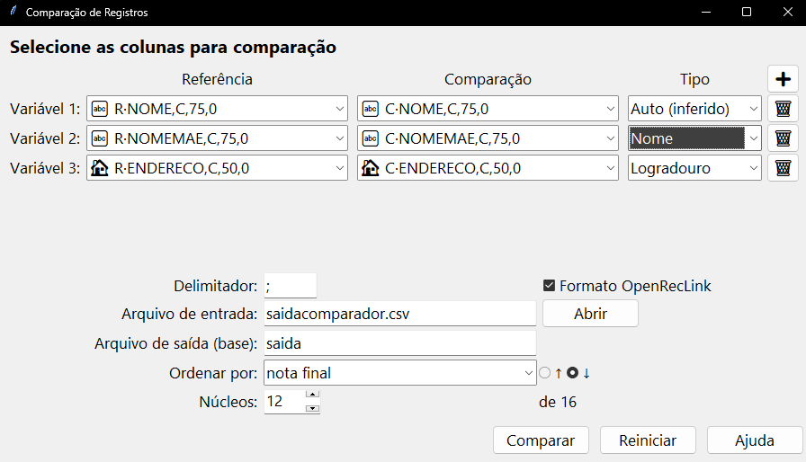

# Comparador de Registros

[](https://github.com/marco-jardim/Comparador-de-Registros/actions/workflows/build-release.yml)
[](https://codecov.io/gh/marco-jardim/Comparador-de-Registros)

[](LICENSE)

**Comparador de Registros** é uma ferramenta Python focada em deduplicação e vinculação probabilística de bases cadastrais, especialmente em contextos de saúde pública, assistência social e cadastros massivos, onde inconsistências de grafia, abreviações e datas trocadas comprometem a análise de dados.

<p align="center">
	<a href="app.png"></a>
</p>

**Motivações principais**

- Reduzir falsos negativos ao comparar registros que parecem diferentes, mas representam a mesma pessoa.
- Tornar reprodutível um processo que antes dependia de planilhas manuais e macros difíceis de manter.
- Oferecer resultados rastreáveis, com pontuação explicável e colunas auxiliares que justificam cada nota.

**Funcionalidades de destaque**

- **Interface gráfica interativa (Tkinter)** com barra de progresso, escolha de separador, número de núcleos e mapeamento rápido das colunas relevantes.
- **Comparadores especializados** para nomes, datas, localidades, logradouros e campos textuais, aproveitando bibliotecas otimizadas (RapidFuzz, python-Levenshtein, Jellyfish) com fallback automático para ambientes restritos.
- **Cache e construção incremental de frequências**, permitindo reaproveitar estatísticas de grandes bases e acelerar execuções subsequentes.
- **Suíte completa de testes (unitária, integração e funcional)** e pipeline GitHub Actions que executa `pytest`, calcula cobertura e empacota executáveis multiplataforma com PyInstaller.

> 🗂️ **Estrutura do repositório (resumo)**
>
> ```text
> src/
> ├─ gui.py                  # Interface Tk
> ├─ comparaRegistros.py     # Núcleo de pontuação
> ├─ freqBuilder.py          # Construção e cache de tabelas de frequência
> ├─ util.py                 # Normalização, Soundex e distâncias
> ├─ comparators/            # Comparadores especializados
> ├─ transformaBase.py       # Conversão de bases legadas
> └─ ...
> tests/
> ├─ unit/                   # Testes de unidade
> ├─ functional/             # Fluxos completos usando CSVs reais
> └─ integration/            # Testes entre módulos principais
> .github/workflows/         # Pipeline CI (testes + build + release)
> pyproject.toml             # Metadados, módulos e dependências de instalação
> requirements.txt           # Dependências de execução e testes, com faixas de versão
> README.md                  # Este guia
> LICENSE                    # GPL-3.0
> ```

---

## 1. Pré-requisitos

| Item    | Versão sugerida | Observação                                       |
| ------- | ---------------- | ------------------------------------------------ |
| Python  | 3.11 ou superior | CI oficial roda em 3.11; localmente testado até 3.13 |
| pip     | Última versão    | `python -m pip install --upgrade pip`            |
| Git     | Opcional         | Facilita baixar e atualizar o repositório        |

Tkinter acompanha as distribuições oficiais do Python (Windows/macOS). Em Linux Debian/Ubuntu instale com `apt install python3-tk`.

---

## 2. Instalação passo a passo (para iniciantes)

### 2.1 Clonar o projeto

```bash
git clone https://github.com/marco-jardim/Comparador-de-Registros.git
cd Comparador-de-Registros
```

> Alternativa: baixe o ZIP pelo botão **Code ▾ ➜ Download ZIP** e extraia.

### 2.2 Criar e ativar um ambiente virtual

```bash
python -m venv .venv

# Ativar (Windows PowerShell)
.venv\Scripts\Activate.ps1

# Ativar (Linux/macOS/Git Bash)
source .venv/bin/activate
```

Finalize com `deactivate` quando quiser sair do ambiente virtual.

### 2.3 Instalar o projeto

```bash
python -m pip install --upgrade pip
pip install -e .
```

O `pyproject.toml` instala pandas, RapidFuzz, python-Levenshtein, Jellyfish e Unidecode nas mesmas faixas de versão do `requirements.txt`. Para instalar também pytest e pytest-cov, use `python -m pip install -e ".[test]"`. O `requirements.txt` continua disponível para o fluxo de CI existente.

A instalação preserva os nomes existentes: `comparaRegistros`, `freqBuilder`, `gui`, `transformaBase`, `util` e o pacote `comparators`. Não é necessário acrescentar `src/` ao `PYTHONPATH`. Tkinter é fornecido pela distribuição do Python ou pelo sistema operacional, não pelo pip.

---

## 3. Testes automatizados

A suíte de testes usa **pytest** e cobre cenários de unidade, integração e fluxo completo.

```bash
(.venv) pytest --cov=src --cov-report=term-missing
(.venv) pytest tests/unit      # apenas unitários
(.venv) pytest -k nomes        # filtra por expressão
```

Os testes são executados automaticamente no GitHub Actions antes de cada build e o relatório de cobertura é enviado ao Codecov. É altamente recomendado rodá-los localmente antes de abrir um Pull Request ou gerar executáveis.

### Equivalência com o protótipo Java

O protótipo Java não está publicado neste repositório. O teste de equivalência só roda com a cópia local do autor e JDK 21 ou superior, sendo pulado na CI com o motivo informado pelo pytest. Por padrão, os fontes são procurados em `legado/src/principal`; a variável de ambiente opcional `CDR_LEGADO_DIR` permite indicar outro diretório de fontes `*.java` (caminho absoluto ou relativo à raiz do repositório). Quando os fontes estão presentes, erros de compilação fazem o teste falhar, não são motivo para pulá-lo.

Para executar a equivalência localmente e exibir o motivo de eventuais skips:

```bash
python -m pytest tests/equivalencia/test_equivalencia.py -v -rs
```

---

## 4. Executar a aplicação (GUI)

```bash
(.venv) python src/gui.py
```

### 4.1 Uso rápido

1. **Abrir CSV** → clique em **Abrir** e selecione o arquivo de entrada.
2. **Configurar colunas** → ajuste as letras das colunas nos comboboxes se o layout não for o padrão.
3. **Comparar** → clique em **Comparar** para iniciar o processamento. A barra de progresso mostra o andamento e, ao final, `saida.csv` é criado com o mesmo separador do arquivo original.

O resultado é ordenado pela nota final (decrescente). Alterar o critério de ordenação antes de iniciar reflete imediatamente no arquivo gerado.

### 4.2 Mapeamento de colunas padrão

| Coluna | Campo             |
| ------ | ----------------- |
| J      | Nome 1            |
| K      | Nome da mãe 1     |
| L      | Data de nascimento 1 |
| N      | Nome 2            |
| O      | Nome da mãe 2     |
| P      | Data de nascimento 2 |

Se os nomes das colunas forem simples (sem prefixos do OpenRecLink), desmarque **Formato OpenRecLink** antes de abrir o arquivo. O separador padrão é vírgula (`,`); no modo OpenRecLink é pipe (`|`). Ambos podem ser alterados no campo **Separador**.

### 4.3 Uso de múltiplos núcleos

A caixa **Núcleos** define quantos processadores serão utilizados para paralelizar a comparação. O valor inicial corresponde a 75 % dos núcleos disponíveis, mas você pode aumentar ou reduzir conforme o hardware.

---

## 5. Uso como biblioteca

O projeto não oferece uma CLI de processamento. Para automatizar comparações, use as funções Python existentes após a instalação:

```python
from comparators import comparar_data
from comparaRegistros import processar

resultado = comparar_data("19900101", "19900101")
print(resultado.nota)

# Índices iniciados em zero: Nome1, Mãe1, Data1, Nome2, Mãe2, Data2.
processar("entrada.csv", "saida", (9, 10, 11, 13, 14, 15), sep="|")
```

`processar` grava `saida.csv`. A GUI continua sendo iniciada por `python src/gui.py` no repositório; a instalação não cria novos comandos executáveis.

---

## 6. Cache das tabelas de frequência

Na primeira execução, o sistema cria a pasta `.freq_cache/` processando o CSV em blocos de aproximadamente 500 mil linhas. Se a base for atualizada ou o cache ficar obsoleto, basta removê-lo:

```bash
rm -r .freq_cache
```

O diretório será reconstruído automaticamente em uma nova execução.

---

## 7. Perguntas frequentes

| Problema / Mensagem                                      | Causa provável                         | Como resolver                                                        |
| -------------------------------------------------------- | -------------------------------------- | -------------------------------------------------------------------- |
| `ModuleNotFoundError: pandas`                            | Ambiente virtual não ativado           | Rode o comando de ativação do venv e reinstale as dependências       |
| GUI abre mas congela sem barra de progresso              | Script incorreto foi executado         | Utilize `python src/gui.py` em vez de chamar módulos internos        |
| Notas muito diferentes das versões antigas               | Tabelas de frequência desatualizadas   | Exclua `.freq_cache/` para reconstruir com a base atual              |
| RapidFuzz/python-Levenshtein não instala (ambiente ARM)  | Sem wheels pré-compiladas              | A aplicação funciona com fallback Python puro, porém mais lento      |
| Erros com vírgula decimal (`ValueError: could not parse`) | Dados com `2,00` ou similar            | Versões atuais normalizam automaticamente; garanta estar na branch main |

---

## 8. Pipeline e build de executáveis

- O workflow `build-release.yml` roda em todo push para `main` e em PRs abertos, atualizados, reabertos ou fechados contra `main`.
- Os testes rodam independentemente da preparação de versão. Preparação de versão, build e release só rodam em push para `main` ou PR fechado e mesclado; o build depende da versão e da aprovação dos testes, e a release depende do build.
- Executáveis são empacotados com **PyInstaller** para Windows, macOS e Linux e publicados como artefatos.

Para gerar manualmente um executável local (exemplo em Windows, com venv ativo):

```bash
(.venv) pyinstaller --noconfirm --onefile --add-data "version.env;." src/gui.py
```

Em sistemas Unix-like substitua `;` por `:` dentro do argumento `--add-data`. O arquivo `version.env` é criado automaticamente no pipeline; para gerar manualmente em desenvolvimento, crie o arquivo com o conteúdo:

```text
APP_VERSION=0.0-dev
APP_VERSION_DATE=2025-09-26
```

Substitua pelos valores desejados (por exemplo, usando a data atual). Executar o workflow no GitHub também produz o `version.env` correto como parte dos artefatos.

---

## 9. Contribuindo

1. Abra uma issue para discutir mudanças maiores (ex.: novos formatos de entrada, integrações externas).
2. Crie um branch dedicado.
3. Rode `pytest` antes do commit final para garantir que a suíte continue verde.
4. Abra o Pull Request seguindo o estilo PEP 8 e descrevendo o impacto da alteração.

Contribuições pequenas (refactors, documentação, traduções) também são muito bem-vindas.

---

## 10. Licença

Distribuído sob a **GNU General Public License v3.0**. Consulte o arquivo [`LICENSE`](LICENSE) para detalhes completos.

## 11. Autoria, versão da tese e equivalência com Java

O protótipo Java foi desenvolvido por **Daniele B. Peçanha**, em 2015, no IESC-UFRJ, conforme [`legado/src/principal/LEIAME`](legado/src/principal/LEIAME). O algoritmo tem como referência a dissertação de **Francisca de Fátima de Araújo Lucena (2013)**, *Uso de algoritmos computacionais para a classificação de pares de registros provenientes do relacionamento probabilístico de bancos de dados: uma aplicação em saúde pública*.

A tag anotada **`v0.1.0-tese`** aponta para **`3b43598`**, HEAD de `main` em 29/09/2025. O extrato usado na tese é compatível com a faixa **`1b9236b..3b43598`**, mas o commit gerador exato não foi confirmado pela equipe. A tag registra essa referência histórica, não uma confirmação de proveniência exata. A versão de empacotamento `0.1.0` não significa que as alterações posteriores de empacotamento já existissem naquele commit.

O [PR #25](https://github.com/marco-jardim/Comparador-de-Registros/pull/25) acrescentou a comparação entre Python e o protótipo Java em lote sintético de nomes e datas. O [relatório de equivalência](tests/equivalencia/relatorio_equivalencia.md) documenta concordâncias, divergências e limites: a equivalência é parcial, não uma identidade entre as implementações. Os testes em `tests/equivalencia/` exigem JDK 21 ou superior para executar a comparação com Java.

A CI existente gera versões de executáveis a partir de tags `v*` no formato numérico `v0.N`. A tag histórica `v0.1.0-tese` não segue esse formato; o workflow de release precisa ser revisto antes de uma próxima execução de release. Esta alteração não modifica o workflow nem publica pacotes no PyPI.
